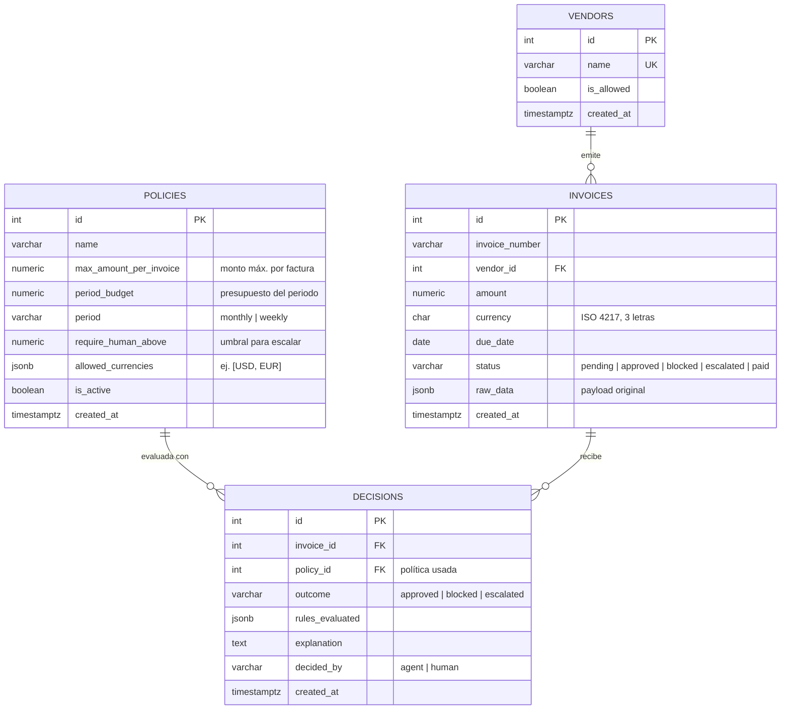

# Paso 1 — Modelo de base de datos (Blinka MVP)

## Diagrama entidad-relación



> Los campos que **no** estaban en tu modelo original son: `policies.name`, `policies.period`,
> `policies.is_active`, `policies.created_at`, `vendors.created_at`, `decisions.policy_id`
> y `decisions.decided_by`. Son baratos y cada uno resuelve un problema concreto (ver abajo).

## Restricciones e índices

| Tabla | Restricción / índice | Por qué |
|---|---|---|
| invoices | `UNIQUE (vendor_id, invoice_number)` | Evita pagar dos veces la misma factura (la regla anti-duplicados sale gratis). |
| invoices | `CHECK (amount > 0)` | Datos basura fuera. |
| invoices | `CHECK (status IN (...))` | Estados válidos. |
| invoices | índice en `status`, `vendor_id` | Bandeja de pendientes / escaladas en el frontend. |
| decisions | `CHECK (outcome IN ('approved','blocked','escalated'))` | Estados válidos. |
| decisions | índice en `(invoice_id, created_at DESC)` | Obtener la última decisión de una factura. |
| policies | índice parcial único `ON (is_active) WHERE is_active` | Solo una política activa a la vez. |
| vendors | `UNIQUE (name)` | Matching por nombre al ingerir facturas. |

Montos: usar `NUMERIC(14,2)`, nunca `float`.

## Decisiones de diseño

1. **`decisions` es 1:N con `invoices`, no 1:1.** Una factura escalada recibe primero una
   decisión del agente (`escalated`, `decided_by='agent'`) y después la de un humano
   (`approved`/`blocked`, `decided_by='human'`). Así queda el historial completo para la demo.
2. **`invoices.status` es estado actual; `decisions` es el log inmutable.** Al registrar una
   decisión se actualiza `status` en la misma transacción.
3. **`decisions.policy_id`** guarda qué versión de reglas se aplicó. Si en la demo cambias los
   umbrales, las decisiones viejas siguen siendo explicables. Para versionar: no edites una
   política, crea una nueva y desactiva la anterior.
4. **`period_budget` no necesita tabla extra.** El gasto del periodo se calcula:
   ```sql
   SELECT COALESCE(SUM(i.amount), 0)
   FROM invoices i
   WHERE i.status IN ('approved', 'paid')
     AND i.currency = :currency
     AND i.created_at >= date_trunc('month', now());
   ```
   (Con varias monedas, el presupuesto se interpreta por moneda o en una moneda base; para el
   MVP recomiendo una sola moneda base.)
5. **`rules_evaluated` (JSONB)** con forma fija para que el frontend lo pinte sin lógica extra:
   ```json
   [
     {"rule": "vendor_allowed",        "passed": true,  "detail": "ACME está en la lista"},
     {"rule": "currency_allowed",      "passed": true,  "detail": "USD permitido"},
     {"rule": "max_amount_per_invoice","passed": true,  "detail": "1200 <= 5000"},
     {"rule": "period_budget",         "passed": true,  "detail": "Gastado 8000 + 1200 <= 20000"},
     {"rule": "require_human_above",   "passed": false, "detail": "1200 > 1000 → escalar"}
   ]
   ```
6. **Precedencia del resultado** (se implementará en el motor de reglas):
   cualquier regla dura falla (vendor, moneda, monto máx., presupuesto) → `blocked`
   (los duplicados se rechazan antes, con un 409 en la API);
   si no, supera `require_human_above` → `escalated`; si no → `approved`.
